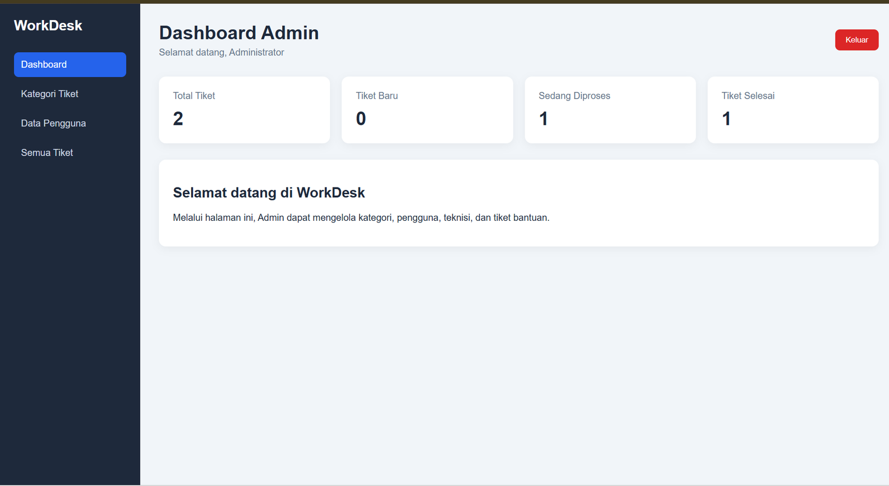
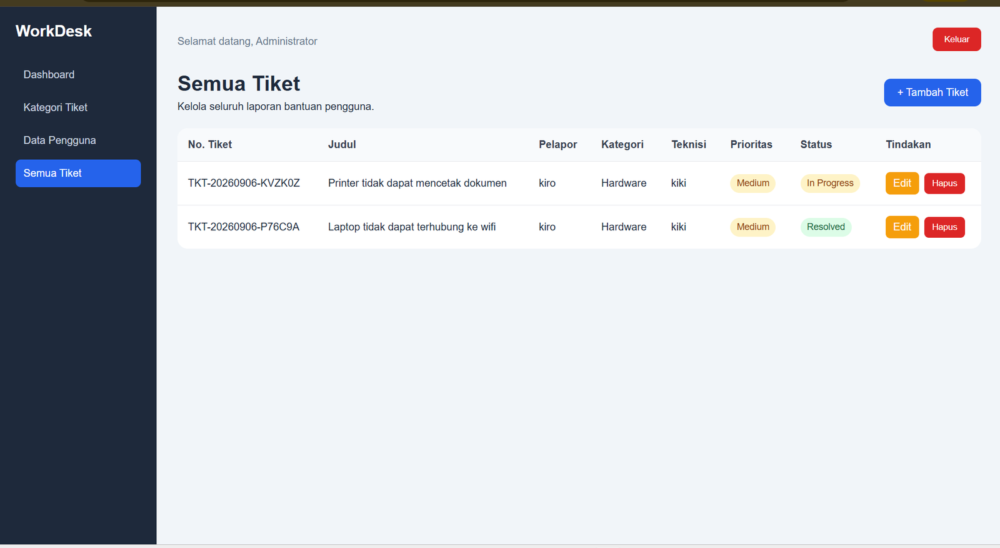
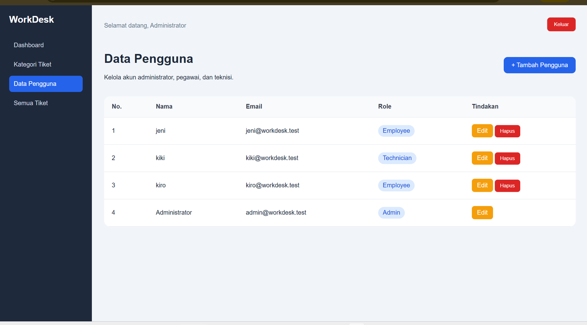
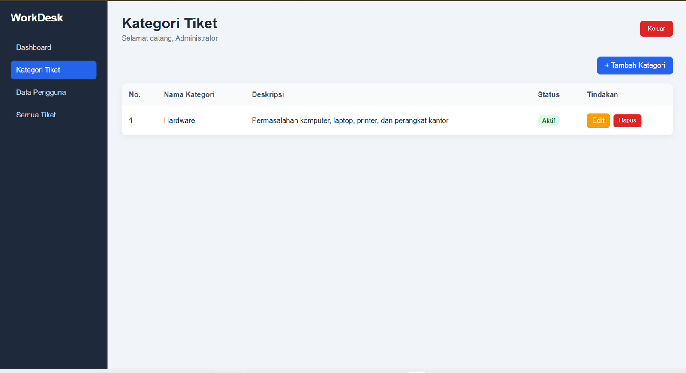
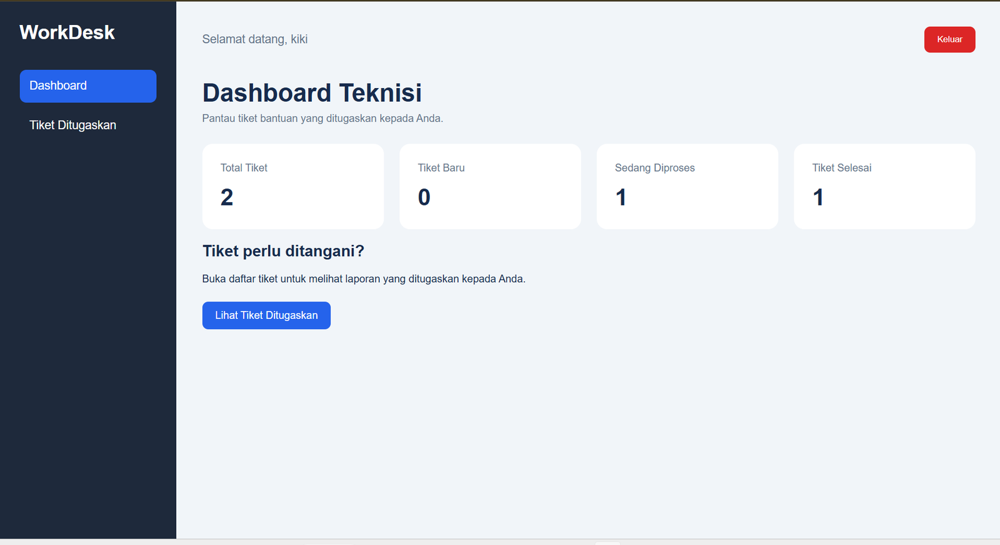
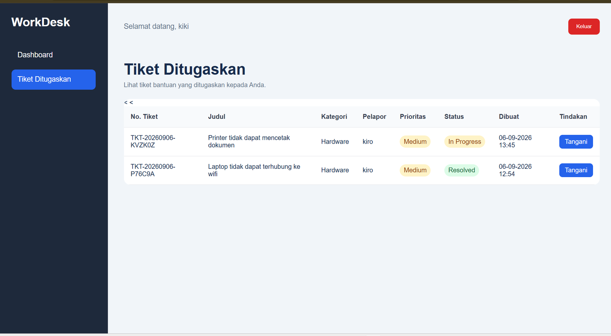

# WorkDesk — IT Helpdesk Ticketing System

**WorkDesk** is a web-based IT helpdesk ticketing application built with **Laravel 12** and **MySQL**. It helps employees report IT issues, administrators manage support requests and assign technicians, and technicians track and update the progress of their assigned tickets.

> **Project status:** Functional MVP / personal web-development portfolio project. The application is demonstrated locally; no public live demo is provided.

## Key Features

### Administrator
- Dashboard showing total, new, in-progress, and resolved ticket counts.
- Manage ticket categories, including descriptions and active/inactive status.
- Manage user accounts and assign **Admin**, **Employee**, or **Technician** roles.
- Create, view, edit, and delete support tickets.
- Assign tickets to technicians, set priorities, and update ticket statuses.

### Employee
- Log in to an employee-specific dashboard.
- Submit IT support tickets with a category, title, description, and priority.
- View tickets submitted under their own account and follow their status.

### Technician
- View a dashboard and the tickets assigned to their account.
- Access and update only assigned tickets.
- Update ticket status as work progresses.

### Technical Highlights
- Role-based route protection with Laravel authentication and middleware.
- Server-side validation for ticket, category, and user forms.
- Password hashing and session-based login/logout.
- Eloquent models and relationships for users, tickets, and categories.
- Database migrations, Blade templates, and paginated data tables.
- Unique ticket numbers and priority/status indicators.

## Technology Stack

| Layer | Technology |
| --- | --- |
| Backend | PHP 8.2+, Laravel 12 |
| Frontend | Laravel Blade, HTML, CSS, JavaScript |
| Database | MySQL |
| Assets / tooling | Vite, npm, Composer |
| Local development | XAMPP or another PHP/MySQL environment |

## Ticket Workflow

1. An **Employee** submits a ticket describing an IT issue.
2. An **Administrator** reviews the ticket and assigns a technician.
3. The assigned **Technician** works on the request and updates its status.
4. The **Administrator** and **Employee** can monitor ticket progress through their respective views.

Ticket priorities: `low`, `medium`, `high`. Ticket statuses include `open`, `in_progress`, `resolved`, and `closed` (available actions depend on the user's role).

## Screenshots

The following screenshots were captured from the local application.

### Admin Dashboard


### Ticket Management


### User Management


### Ticket Categories


### Technician Dashboard


### Assigned Tickets


## Getting Started

### Prerequisites
- PHP 8.2 or newer
- Composer
- MySQL
- Node.js and npm

### Installation

1. Clone the repository and enter the project directory:

   ```bash
   git clone https://github.com/deaadeliana/workdesk-helpdesk.git
   cd workdesk-helpdesk
   ```

2. Install PHP and frontend dependencies:

   ```bash
   composer install
   npm install
   ```

3. Create a local environment file:

   **Windows (PowerShell):**
   ```powershell
   Copy-Item .env.example .env
   ```

   **macOS / Linux:**
   ```bash
   cp .env.example .env
   ```

4. Create an **empty** MySQL database named `workdesk_helpdesk` (or choose a different name) and configure `.env`:

   ```env
   APP_NAME=WorkDesk
   APP_ENV=local
   APP_DEBUG=true
   APP_URL=http://127.0.0.1:8000

   DB_CONNECTION=mysql
   DB_HOST=127.0.0.1
   DB_PORT=3306
   DB_DATABASE=workdesk_helpdesk
   DB_USERNAME=root
   DB_PASSWORD=
   ```

   Adjust the database username and password to match your local MySQL setup. Never commit your real `.env` file.

5. Generate the application key and run migrations **on the new, empty database**:

   ```bash
   php artisan key:generate
   php artisan migrate
   ```

6. Build frontend assets and start the application:

   ```bash
   npm run build
   php artisan serve
   ```

7. Open **http://127.0.0.1:8000** in your browser.

### First Admin Account

The repository does **not** currently include a ready-to-use admin demo account. After installing on a **fresh database**, create a private local admin account using Laravel Tinker:

```bash
php artisan tinker
```

```php
\App\Models\User::create([
    'name' => 'Local Admin',
    'email' => 'admin@local.test',
    'password' => \Illuminate\Support\Facades\Hash::make('REPLACE_WITH_A_PRIVATE_PASSWORD'),
    'role' => 'admin',
]);
```

Replace the placeholder password before running the command. Log in as the admin to create Employee and Technician accounts from the user-management page.

> **Existing local installations:** Do not run `php artisan migrate:fresh` or replace your current database to follow these instructions; those actions can destroy existing data.

## Repository Notes

- This repository is intended as a learning and portfolio project, not a production-ready helpdesk service.
- Screenshots show illustrative local test records.
- Real passwords, API keys, `.env`, and database backups containing personal data must not be committed.
- Current features and behavior are based on the MVP implementation; automated test coverage and production deployment have not been claimed.

## Developer

Created by **[@deaadeliana](https://github.com/deaadeliana)** as a Laravel web-development portfolio project.
